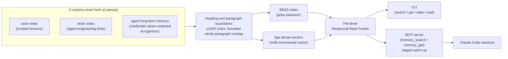

# memory-rag

**A personal-memory RAG that gives my AI coding agent long-term recall** — hybrid retrieval (BM25 + dense vectors + reciprocal-rank fusion) over three default corpora of engineering notes, with optional textbook PDF and historical stock sources, exposed through a custom [MCP](https://modelcontextprotocol.io) server. Retrieval is checked against versioned goldens; reported scores below belong to their dated corpus snapshots.

   

> Why: an AI agent forgets everything between sessions. I keep three growing bodies of notes — hard-won incident lessons, textbook study notes, and the agent's own long-term memory files. This project turns them into a retrieval service the agent queries *before* repeating a mistake I already paid for.

## Architecture



## What's interesting about it

**Evaluation as the acceptance gate.** A 23-query golden set (`golden/golden_queries.json`, expectations judged at file level) is versioned in the repo and treated like a test suite: the 2026-09-16 baseline was **hybrid 23/23, MRR 0.806 (1,938 chunks, 2026-09-16)**; BM25-only holds 22/23 but its MRR decays as the corpus grows (.852 at 937 chunks → .800 at 1,938), which is exactly what the dense leg is there to absorb — fusion held .835 → .838 over the same +5.7% of chunks. Five of the 23 entries were not written by hand — and the MRR *fell* from .846 to .806 when they came in, on purpose: they are real questions the retriever answered poorly. q19 came from `mr.py log` mines the query log for *implicit positives* (a real `memory_search` followed within 120 s by a `memory_get` of one of its hits) and emits them as ready-to-curate golden entries. Curation still rejected the second-ranked file — it discusses the same command for a different purpose — and the entry is kept even though it is the one positive the confidence gate only labels `medium`, because a ruler that only contains questions the system already answers confidently measures nothing. Any change to the golden set requires re-running the eval and recording a new baseline — the ruler stays stable even when a higher score is tempting.

**Cold-start profiling, then fixing the right leg.** First query used to take 35.5s. Per-stage timing showed **88% was `import torch`** (31.4s of Windows DLL loading) — model load was 0.1s and a warm query 0ms. Fix: the MCP server does a *staged main-thread warm-up* right after answering the protocol handshake, cutting the first in-session query from **35s to 0.45s**. (A background-thread import was tried and rejected: the GIL contention made it ~2× slower.)

**Honest degradation.** If vector dependencies aren't installed, hybrid/vec modes automatically fall back to BM25 — and the result explicitly *says so* in a `note` field, so a fallback result is never mistaken for a fusion result.

**Security at ingestion.** The agent-memory corpus may contain `password:`/`token:`/`api_key:` lines. A redaction pass keeps the *keys* searchable ("where do I keep the X credential?") while replacing every *value* with `<REDACTED>` before anything enters an index or leaves through a tool.

**Retrieval findings from a 3-step query-language experiment.** Query in the corpus's language (English queries lost both the lexical leg and the zh-tuned dense leg); rare domain terms beat frequent entity words (which match everything and discriminate nothing); and when you already know the file, `get` beats search.

**MCP hygiene.** stdout is reserved for the protocol stream; all library prints are rerouted to stderr, so no stray `print` can corrupt the JSON-RPC channel.

## Usage

```bash
py -3.12 mr.py stats                     # corpus / tokenizer / vector-layer status
py -3.12 mr.py search "<query>"          # --mode bm25|vec|hybrid (default hybrid)
py -3.12 mr.py eval --mode all -v        # golden-set eval, three modes side by side
py -3.12 mr.py setup-vec                 # install vector deps + pre-pull the bge model
```

Registered as a user-level MCP server (`memory_search` / `memory_get`), available to every new Claude Code session:

```bash
claude mcp add --scope user rh-memory -- py -3.12 <path>/mr_mcp_server.py
```

## Repo layout

| File | Role |
|---|---|
| `mr.py` | CLI entry: search / get / stats / eval |
| `mr_corpus.py` | Corpus loading, heading-aware chunking, credential redaction |
| `mr_index.py` | BM25 + dense index, md5-incremental embedding cache |
| `mr_tools.py` | Shared search/fusion logic for CLI and MCP |
| `mr_mcp_server.py` | MCP server with staged warm-up |
| `golden/golden_queries.json` | 23-query golden eval set (18 hand-written + 5 mined from real usage) |
| `mr_mine.py` | Mines Claude Code session transcripts for implicit positives, ranks them against the live retriever |

The corpora themselves are personal notes and are **not** included; the golden set documents the retrieval contract. Original operational notes (Chinese): [`docs/ops-notes.zh.md`](docs/ops-notes.zh.md).

### Retrieval scope and passage checks (2026-09-17)

Default note BM25 statistics exclude stock/PDF material; `source="stock"` retains the existing non-PDF statistics and is advertised by both MCP tools. Hybrid file ranking and representative passage selection are separate, so a body passage can replace an index line without moving the file. `memory_get(..., heading=...)` retrieves that exact Markdown passage.

Evaluation documents and report sections have explicit purpose labels in `corpus-policy.json` or `rag_purpose` frontmatter. They are excluded by default and remain accessible with `include_evaluation=true`. Initial load and corpus reload scan known golden question strings for warnings; expected answers never affect ranking, filtering or confidence. Searches expose the corpus SHA and audit status. Literal warnings need review: ordinary knowledge can quote a question too, and paraphrases can escape this check.

The evaluator distinguishes actual returned-item ranks, historical deduplicated-document ranks, and required facts in the returned snippet. All MRR@10 metrics stop at rank ten. The original eight extra checks remain intact; a private overlay now labels all 23 ordinary positive questions, including multi-passage requirements. Label coverage is not answer accuracy. Its hash and limits are in [`docs/evidence-coverage.json`](docs/evidence-coverage.json); private sources, full labels and result snippets are excluded from commits.

Use `mine-transcripts --unranked` for held-out candidates: the original miner retrieves candidates before filtering by difficulty. `scripts/sealed_eval.py` freezes source-reviewed labels and consumes the first evaluation exactly once, including failed attempts. This enforces result holdout, not independent human authorship. Quality ablations and uncached latency checks are separate; see [the evaluation guide](docs/retrieval-evaluation.zh.md).

Commands, label format, split discipline and real MCP verification: [`docs/retrieval-evaluation.zh.md`](docs/retrieval-evaluation.zh.md). Existing MCP sessions need to reconnect to load code and schema changes.

The 2026-09-18 follow-up makes corpus contamination a failing preflight in `eval` (also available as `audit-corpus`), supports unique heading prefixes with candidate suggestions, and records Git delivery state in the versioned report generator. Reports require a committed, clean worktree. Performance observations and remaining experiments are tracked separately in [`docs/next-experiments.zh.md`](docs/next-experiments.zh.md).

### Mining the golden set from real usage (2026-09-16)

- **The project's own query log was the wrong place to look.** `.cache/query-log.jsonl` only sees traffic that goes through the MCP server: across 865 Claude Code sessions / 2,366 user turns, `memory_search`/`memory_get` were called **11 times**, while the agent read the same corpus files directly (`Read`/`cat`/`grep`) **477 times**. A silent instrument can mean “no problem” or “nobody uses it”, and the two look identical. The session transcripts are the real log.
- `py -3.12 mr.py mine-transcripts [--days N] [--multi]` walks the transcripts and emits *implicit positives* — a user turn followed, in the same turn, by the agent reading exactly one corpus file — the same shape as the query log's search→get pairs. Three systematic false positives are filtered before anything is shown: files read because a standing rule says so (not because they answer the question), turns that read several files while *doing* work (N−1 of those are tooling reads, so single-file turns only by default), and labels that are simply worse than the retriever's own top hit.
- **Candidates are ranked against the live retriever before a human sees them.** Entries the system already answers at rank ≤3 are dropped (adding them only inflates the score); only misses and rank 4–10 are shown, as ready-to-curate JSON. 419 raw pairs → 19 question-shaped single-file candidates → 11 worth reading → 4 accepted (q20–q23). Two of the four turned out to be cases where the retriever was right and the mined label was too narrow; curation added the second true source rather than penalising the retriever.
- Mined candidates are checked against the existing sets first: the one “zero-hit negative” the query log produced was already in `golden_negative.json` — an echo of the run that built it.

### Hot reload & optional PDF source (2026-09-08)

- **Hot reload**: the index now re-checks a corpus fingerprint (file name / mtime / size) at most every 5 s and rebuilds incrementally — new notes are searchable on the next query without restarting the MCP server (tokenisation and embeddings are md5-cached, so a rebuild costs ~2 s).
- **PDF source, two switches**: `MR_PDF=1` loads the textbook PDFs page-by-page (`py -3.12 mr.py pdf-extract` once; text cached under `.cache/`, never committed). Default search still covers only the three note corpora; pass `source="pdf"` to search the original pages, then `memory_get("<book>.pdf#p81")` for the page ±1.
- **Cross-encoder as a gate, not a re-ranker**: `MR_RERANK=bge-reranker-base` (or `bge-reranker-v2-m3`; `pull-model` fetches either) uses a bounded cross-encoder gate. The ordinary-note base profile scores three hits first (256 tokens, at most two 450-character windows per chunk), expanding to the original five only when evidence is weak; scoring never extends beyond returned `topk`. PDF, stock, and v2-m3 retain their original budgets; shortening PDF input failed a positive-case check. Thresholds require calibration for the selected configuration; `confidence` is relevance, not answer correctness. Measured 2026-09-08: used as a *re-ranker* it lowers MRR on both goldens (notes .835 → .692 / .764, PDF .917 → .748 / .817 — the fused top ranks were already right, and a 480-token window prefers answer-shaped passages), so the default mode is `gate`: order untouched, all 30 positives stay `high` (base model), and the 12 unanswerable questions go low 8 / medium 3 / high 1 versus 2 / 7 / 3 with score floors alone. Cost is ~3 s per query on CPU (~0.5 s on GPU); heavy models load lazily.
- **Observability and a confidence label**: every `memory_search` / `memory_get` appends a JSONL line under `.cache/` (never committed); `py -3.12 mr.py log` mines it — zero-hit real questions (corpus gaps / negative candidates) and "search then `memory_get` of a hit within 120 s" pairs, emitted as ready-to-curate golden entries. Results now carry `confidence` (`high` = both legs above their calibrated floor, `medium` = one leg, `low` = neither, "probably not in the corpus") plus the raw `gate` numbers. Calibrated on `golden/golden_negative.json` (12 unanswerable questions): all 30 positives are `high`; negatives split low 2 / medium 7 / high 3. On a broad personal corpus a score gate can *label* evidence strength but cannot cleanly *refuse* (function-word BM25 hits reach 19, semantic neighbours reach cos .60), so the default only annotates (`MR_GATE=drop` to empty `low` results); per-hit filtering was rejected because correct answers are often seen by one leg only.
- **Embedding model, one-key switch**: presets in `mr_index.MODELS` — `bge-small-zh-v1.5` (default, 24M, 512 tokens), `bge-m3` (568M, 8192 tokens), `Qwen3-Embedding-0.6B` (32k tokens) — each carrying its own query instruction (bge-zh needs the Chinese instruction, bge-m3 none, Qwen3 an `Instruct:` prefix; swapping the model without swapping the prefix silently degrades) and its own md5-incremental cache (`.cache/emb-<model>.npy`, so switching back costs nothing). Choose per process (`MR_EMBED_MODEL`), per query (`memory_search(model=...)`) or per CLI call (`--model`); `py -3.12 mr.py pull-model bge-m3` fetches weights from the HF mirror (resumable; detects the mirror's 15-byte "Entry not found" placeholders). Measured 2026-09-08 on the same 3,116 chunks: on the note corpus the models tie (small 18/18 · MRR .835 vs bge-m3 17/18 · .822), on textbook PDF pages bge-m3 wins clearly (12/12 · .917 vs 11/12 · .694) — truncation only costs when the unit is long and the answer is not in its lead. Hence `MR_EMBED_MODEL_PDF=bge-m3` routes only `source="pdf"` queries to the bigger model while notes stay on the 4× faster small one. Chunking to fit the 512-token window was tried first and *lost* (hybrid MRR .835 → .764 at 420 chars; multi-vector max-pool .798): the heading-sized chunk is itself the signal.
- Why two switches: mixing 1,296 pages into the default search dropped the main golden set from 18/18 · MRR .835 to 17/18 · .750 — and even with PDF hits filtered out, BM25's corpus statistics drifted (.806). Fix: per-source BM25 indexes + masked vector search. With PDFs loaded, the main golden set is byte-for-byte identical to the no-PDF run. `golden/golden_pdf.json` (12 paraphrased queries with expected page ranges): bm25 11/12 · hybrid 12/12 · MRR .917 with `MR_EMBED_MODEL_PDF=bge-m3` (11/12 · .694 on the small model).
